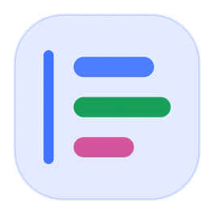
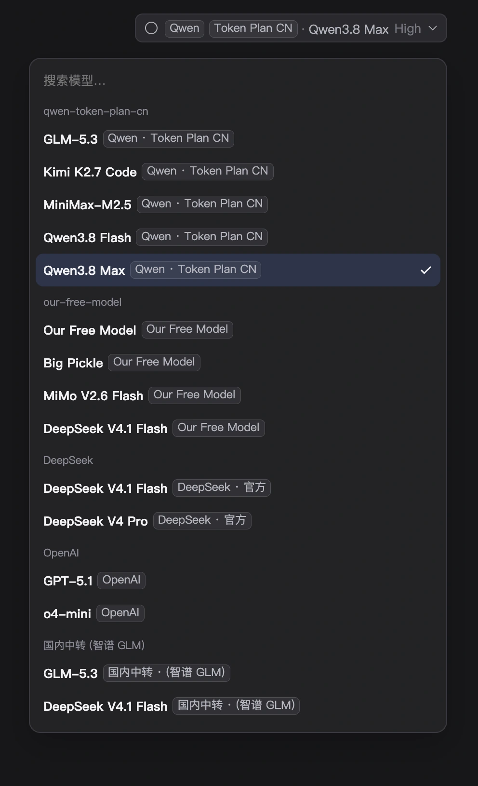
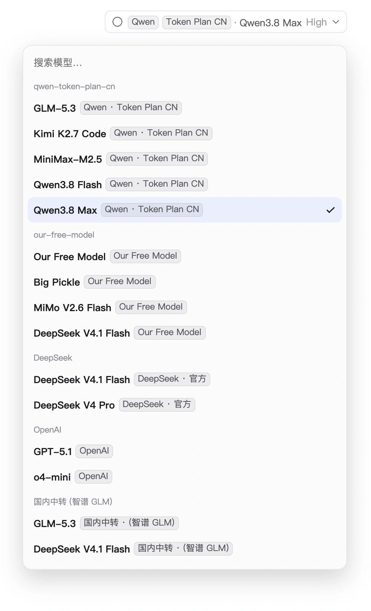
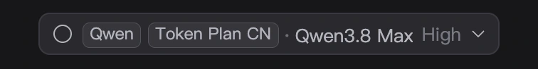
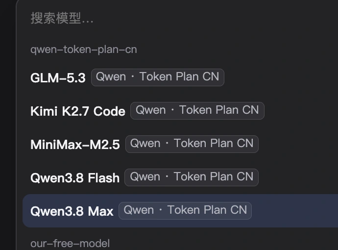
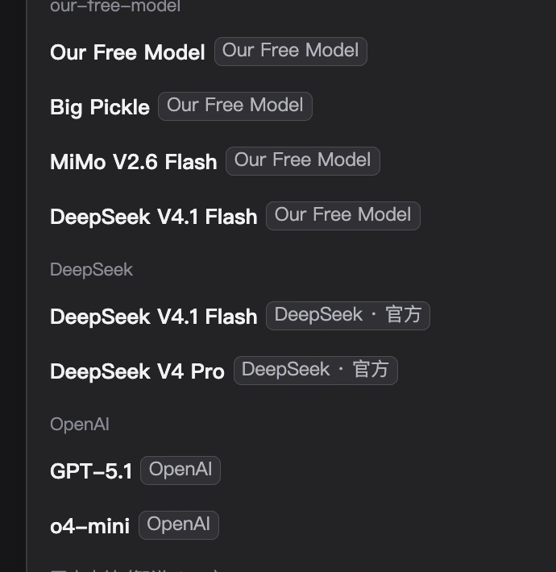

<div align="center">



<br />

<h1>dsh-model-picker-labels</h1>

<p><strong>DeepSeek Harness 插件 · 模型选择框供应商标签</strong><br />
每行写清「哪个模型 + 哪条线路」 · 只加标注不动选择器 · 推理等级中英对照</p>

<p>
  
  
  
  
  
</p>

<p>
  <a href="#界面">界面</a> ·
  <a href="#名称怎么算">名称规则</a> ·
  <a href="#安装">安装</a> ·
  <a href="#配置">配置</a> ·
  <a href="#常见问题">常见问题</a> ·
  <a href="#english">English</a>
</p>

</div>

---

配了多条模型线路之后，DSH 的模型选择框只剩模型名和线路 ID：`Qwen3.8 Flash` 看不出走哪条线，`qwen-token-plan-cn` 又只是噪声；同一个 `DeepSeek V4.1 Flash` 挂在两个供应商下面时，两行长得一模一样。

这个插件只做一件事：**把线路写到模型旁边**。它使用选择框公开的 `conversation.input.model.label` 标签位，在三个位置补上供应商信息，点击、键盘、搜索、勾选全部保持原样。

- **模型按钮**：先把当前线路做成小药丸，再写模型名，例如 `Qwen | Token Plan CN · Qwen3.8 Max`
- **模型列表**：每行是「模型名 + 淡色供应商标签」，例如 `GLM-5.3 [Qwen · Token Plan CN]`
- **推理等级**：中文页面显示成 `关闭(Off)`、`低(Low)`、`高(High)`、`最高(Max)`，三处界面同时生效

<table>
  <tr>
    <td width="50%"></td>
    <td width="50%"></td>
  </tr>
  <tr>
    <td align="center"><sub><b>深色</b> · 跟随宿主主题</sub></td>
    <td align="center"><sub><b>浅色</b> · 同一套令牌</sub></td>
  </tr>
</table>

## 为什么值得装

- **不动选择器**：只往名字旁边补标签，不替换组件、不接管事件；搜索、方向键、回车、勾选都还是官方的。
- **同名模型能分清**：`DeepSeek V4.1 Flash` 在两行时，一个标 `Our Free Model`、一个标 `DeepSeek · 官方`。
- **裸品牌不加噪**：只配了一个 `OpenAI` 时按钮和列表保持原样，插件返回 `null` 交还给宿主默认渲染。
- **不丢模型名**：v0.2 起先探测这一格的渲染方式，整格归插件时自己写「模型名 + 供应商」，否则只补标签。
- **中英对照**：中文页面才有中文档位名，切回英文即时还原；选中与持久化始终用档位 `id`。
- **离线自足**：无第三方依赖、无网络请求、无遥测；只用宿主提供的 `react` 和 `--dsw-alias-*` 主题令牌，深色浅色自动跟随。
- **随时可关**：宿主半身是空的，装完不用重启；在 **设置 → 插件** 里就能停用。

---

## 目录

- [界面](#界面)
- [名称怎么算](#名称怎么算)
- [安装](#安装)
- [更新](#更新)
- [卸载](#卸载)
- [配置](#配置)
- [推理等级中文化](#推理等级中文化)
- [行为边界](#行为边界)
- [常见问题](#常见问题)
- [已知限制](#已知限制)
- [开发](#开发)
- [English](#english)
- [License](#license)

---

## 界面

### 模型按钮



当前线路被拆成两颗小药丸（`Qwen`、`Token Plan CN`），后面接模型名。线路是 ID 形态（含 `-` 或 `_`）时才加药丸，因为这正是 `displayName` 覆盖不掉的编码式线路。

### 模型列表



每行末尾是淡色标签，不抢名字的字重。标签文案是「品牌 · 限定词」，品牌取已知表或 `displayName` 的第一段。

### 同名模型



`DeepSeek V4.1 Flash` 出现在两条线路下时，右边标签不同，一眼就能选中想要的那条。

---

## 名称怎么算

插件读线路的 `id` 和 `displayName`：表里认识的 id 直接展开，用户写过的 `displayName` 原样保留。

| 线路配置 | 按钮上显示 | 列表里的标签 |
|---|---|---|
| `id: qwen-token-plan-cn`（没写 displayName） | `[Qwen] [Token Plan CN] · 模型名` | `Qwen · Token Plan CN` |
| `id: our-free-model` | `[Our Free Model] · 模型名` | `Our Free Model` |
| `id: deepseek-official` | `DeepSeek 官方 · 模型名` | `DeepSeek · 官方` |
| `id: xyz` + `displayName: 国内中转 (智谱 GLM)` | `[国内中转 (智谱 GLM)] · 模型名` | `国内中转 · (智谱 GLM)` |
| `id: openai`（纯品牌） | 不动，沿用默认 | 不动，沿用默认 |

想少折腾 id，最省事的办法是给线路写 `displayName`：

```yaml
# <profile>/cordis.patch.yml（profile 层，覆盖在你的 bundle 之上）
- id: llm-pi-ai
  config:
    providers:
      qwen-token-plan-cn:
        displayName: 通义 · 编程套餐      # 插件会原样显示
        # ...
```

品牌表里已经收了一批常见 id（`deepseek-*`、`qwen`、`dashscope`、`gemini`、`groq`、`z-ai`、`our-free-model` 等）；不在表里的 id 会按 `-`/`_`/`.` 分段、首字母大写，`my-gateway` 读作 `My · Gateway`。

---

## 安装

### 前置条件

- 已安装 **DeepSeek Harness 桌面端**（本插件在 `0.2.2-rc.1` 实测可用）。
- 至少配置了两条线路，或至少有一条 ID 形态的线路——只有一条纯品牌线路时，插件不会改动任何显示。

### 第一步：确认 `dsh` 命令可用

```sh
dsh --version
```

没有这个命令也没关系，用应用包内的绝对路径（macOS）：

```sh
DSH="/Applications/DeepSeek Harness.app/Contents/Resources/runtime/cli/bin/dsh"
"$DSH" --version
```

### 第二步：安装插件

**方式 A：从 GitHub 安装（推荐）**

```sh
dsh plugin --profile desktop add "github:chauvetliu/dsh-model-picker-labels"
```

**方式 B：从本地目录安装（开发/离线）**

```sh
dsh plugin --profile desktop add "link:/绝对路径/dsh-model-picker-labels"
```

**方式 C：插件管理器**：在 GUI 的插件管理器里用 `install_bundle`，target 填本目录的绝对路径。

装完后 `~/.dsh/profiles/desktop/package.json` 里会多出两处：

```jsonc
{
  "dependencies": {
    "dsh-model-picker-labels": "github:chauvetliu/dsh-model-picker-labels"
  },
  "dsh": {
    "profile": {
      "bundles": ["@deepseek-ai/dsh-base", "@deepseek-ai/dsh-web-app", "dsh-model-picker-labels"]
    }
  }
}
```

### 第三步：让它生效

宿主半身是空的，改动只在浏览器半区，**不需要重启**：安装后 HMR 会自己加载，刷新一次页面（⌘R）也可以。如果插件没出现在列表里，再重启一次应用。

### 第四步：确认生效

打开任意对话，点开输入框下方的模型选择器：

- 每一行末尾有淡色标签 → 成功；
- 按钮上是 `Qwen | Token Plan CN · 模型名` → 成功；
- 只有一条纯品牌线路（如 `OpenAI`）→ 保持原样是正常的。

---

## 更新

```sh
# 从 GitHub 安装的
dsh plugin --profile desktop add "github:chauvetliu/dsh-model-picker-labels"
# 本地 link 安装的：git pull 即可
```

更新后刷新页面（⌘R）就够，不必重启。

---

## 卸载

```sh
dsh plugin --profile desktop remove dsh-model-picker-labels
```

也可以手动编辑 `~/.dsh/profiles/desktop/package.json`：删掉 `dependencies` 里的一行和 `dsh.profile.bundles` 里的 `dsh-model-picker-labels`，然后重启或刷新。

插件不写任何配置、凭据或会话数据，卸载不会留下残留，也不会改动你的模型目录。

---

## 配置

只有一个开关，在 `~/.dsh/profiles/desktop/cordis.patch.yml` 里按 id 覆盖（用户 patch 层优先级高于 bundle 层）：

```yaml
- id: model-picker-labels
  name: dsh-model-picker-labels
  config:
    enabled: false     # 关掉渲染，保留安装
```

| 字段 | 默认 | 说明 |
|---|---|---|
| `enabled` | `true` | 是否渲染标签与中文化的档位名 |

日常用 **设置 → 插件** 的开关更省事，效果相同。

---

## 推理等级中文化

供应商适配器公布的档位名原来是英文原样打印。中文页面下插件把目录里的档位名改成「中文(英文原词)」，按钮、根菜单的「推理等级」行和档位列表三处一起生效：

| 适配器写法 | 中文页面显示 |
|---|---|
| `Off` / `none` | `关闭(Off)` / `关闭(none)` |
| `Minimal` / `minimal` | `轻度(Minimal)` / `轻度(minimal)` |
| `Low` / `low` | `低(Low)` |
| `Medium` / `medium` | `中(Medium)` |
| `High` / `high` | `高(High)` |
| `XHigh` / `xhigh` | `极高(XHigh)` |
| `Max` / `max` | `最高(Max)` |

- 已经写成 `最大(Max)` 这种中英混写的会被规整为 `最高(Max)`，不会套娃；
- 供应商只写中文的名字（如 `较低`）保持不动；
- 切回英文页面会还原成英文原词；
- 只改写显示用的 `name`，选中与持久化仍用档位 `id`；
- 模型本身没有公布档位（没有 Effort 行）时，插件不会凭空造出档位。

---

## 行为边界

**不动的东西**：选择器本身的布局、点击、键盘操作、搜索过滤、选中态和勾选标记；根菜单里 Model / Effort 两行的结构；`/model` 命令弹窗（它的行由命令系统的 `label` 文本绘制，扩展点拿不到供应商数据）。

**兼容性探测**：v0.1 只把供应商标签插进原来的名字栏，如果某个版本的模型选择框把这一格整格换成插槽，就会出现「只显示供应商、模型名消失」。v0.2 起插件先探测一次这一格的渲染方式——整格归插件时由插件自己写「模型名 + 供应商」，否则只补标签、原名字保留，两种情况都不会丢掉模型名。

**只读自己这一格**：浏览器半区没有 Harness Client 包依赖（只用宿主提供的 `react`），只读标签位渲染出的 `span[data-provider-id][data-model-id]` 包装，不观察也不写入其它 DOM。

**窄屏降级**：宽度小于 560px 时按钮上的线路药丸隐藏，只留模型名，避免把输入框挤坏。

---

## 常见问题

**装了但没有标签**

1. 是否刷新过页面？（宿主半身是空的，改动全在前端）
2. `~/.dsh/profiles/desktop/package.json` 的 `dsh.profile.bundles` 里有没有 `dsh-model-picker-labels`？
3. 设置 → 插件 里这个插件是开着的吗？

**只有一条线路，看起来完全没变**

符合预期：纯品牌 id（`openai`、`kimi`）不加标签，插件返回 `null` 让宿主画默认样子。想看到区别，再配一条线路，或给它写 `displayName`。

**按钮上只有线路，看不到模型名**

说明命中了 v0.1 的旧问题。升级到当前版本即可；插件会先探测再决定是否自己写模型名。

**`/model` 弹窗里没有标签**

正常：那个弹窗由命令系统绘制，只吃 `label` 文本，拿不到供应商对象。本插件只覆盖主模型按钮和它的列表。

**档位名没变成中文**

- 页面语言不是中文（看 `<html lang>`）时不会改；
- 该模型没有公布推理档位；
- 该档位名不在词表里（如自定义的 `Whatever`）时保持原样。

**标签里的名字不好看**

给该线路写 `displayName`，插件会原样显示；或者到 `core.js` 的 `PROVIDER_ALIASES` / `WORD_CASE` 里补一行，然后跑 `npm run sync`。

---

## 已知限制

- **只覆盖主模型选择框**：`/model` 命令弹窗不在范围内（扩展点拿不到供应商数据）。
- **依赖宿主的标签位**：宿主若移除或重命名 `conversation.input.model.label`，插件会静默失效。
- **依赖一个 DOM 特征**：探测阶段读取 `span[data-provider-id][data-model-id]` 判断渲染形态；宿主改结构时会退回「只补标签」的模式（不会消失，也不会错位）。
- **词表有限**：未知 id 只能机械分段、首字母大写，可能读起来生硬（`my-gateway` → `My · Gateway`）；补 `displayName` 或词表更好。
- **只在 0.2.2-rc.1 桌面端实测**：其它版本的标签位行为未逐一验证。

---

## 开发

```sh
npm run check   # 语法、core 与 client 内嵌部分一致、manifest/导出、名字规则
npm run sync    # 改了 core.js 后，把它同步进 client.js
```

`client.js` 必须单文件注册（Module Loader 只认一个 `load()` 调用），所以纯函数写在 `core.js`，由 `scripts/sync-core.mjs` 复制进 `client.js` 的标记区；`scripts/check.mjs` 会在两边不一致时直接失败。

结构：

| 文件 | 作用 |
|---|---|
| `index.js` | 宿主半身：空 `apply`，只为让包出现在插件列表里、发布 `dsh.client` 行 |
| `client.js` | 浏览器半身：注册标签位、按钮/列表两种形态、探测渲染方式、档位名中文化、样式 |
| `core.js` | 纯函数：线路名拆分、标签文案、颜色/单字、档位名改写（`client.js` 内嵌同一份） |
| `cordis.patch.yml` | bundle 挂载声明与默认配置 |
| `locale/{zh,en}.json` | 插件列表里的标题和描述 |
| `icon.svg` | 插件图标 |
| `docs/` | README 截图与徽章 |
| `scripts/` | `check.mjs` 静态检查、`sync-core.mjs` 同步 |

**改哪里？** 改 `core.js` 后跑 `npm run sync`，再刷新页面；`client.js` 的改动直接刷新即可。`index.js` 与清单的改动需要重启。

---

## English

**dsh-model-picker-labels** is a small plugin for [DeepSeek Harness](https://github.com/deepseek-ai/deepseek-harness). Once you configure more than one model provider, the picker shows only the model name and its route id — you cannot tell which line a model comes from, and identically named models become indistinguishable.

Built on the public extension point `conversation.input.model.label`, it annotates rather than replaces: clicks, keyboard navigation, search, and selection are untouched.

- **Model button** — the current route as small pills before the model name, e.g. `Qwen | Token Plan CN · Qwen3.8 Max`
- **Model list** — every row reads "model name + muted provider label", e.g. `GLM-5.3 [Qwen · Token Plan CN]`
- **Reasoning efforts** — bilingual on Chinese pages: `关闭(Off)`, `低(Low)`, `高(High)`, `最高(Max)`, in all three surfaces

<table>
  <tr>
    <td width="50%"></td>
    <td width="50%"></td>
  </tr>
</table>

### Install

```sh
dsh plugin --profile desktop add "github:chauvetliu/dsh-model-picker-labels"
# local: dsh plugin --profile desktop add "link:/absolute/path/dsh-model-picker-labels"
```

The host half is intentionally empty, so no restart is needed — the client half loads over HMR, or simply refresh the page (⌘R). Toggle it later under **Settings → Plugins**, or override `enabled` in your profile's `cordis.patch.yml`.

### Naming rules

| Provider config | Button | Row label |
|---|---|---|
| `id: qwen-token-plan-cn`, no `displayName` | `[Qwen] [Token Plan CN] · model` | `Qwen · Token Plan CN` |
| `id: our-free-model` | `[Our Free Model] · model` | `Our Free Model` |
| `id: deepseek-official` | `DeepSeek 官方 · model` | `DeepSeek · 官方` |
| `id: xyz` + `displayName: 国内中转 (智谱 GLM)` | `[国内中转 (智谱 GLM)] · model` | `国内中转 · (智谱 GLM)` |
| `id: openai` (bare brand) | unchanged | unchanged |

A `displayName` always wins and is shown as written. A multi-provider setup always differs per row, even when model names repeat.

### Scope and limits

- Covers the main model picker only — the `/model` command popup is drawn by the command system and gets no provider data.
- Depends on the host's `conversation.input.model.label` slot and on `span[data-provider-id][data-model-id]` for its one-time render probe; if the host changes that markup the plugin falls back to label-only mode.
- Unknown route ids are split on `-`/`_`/`.` with title casing; write a `displayName` (or extend the alias table) for nicer wording.
- No third-party dependencies, no network calls, no telemetry; only host-provided React and `--dsw-alias-*` theme tokens.

---

## License

[MIT](LICENSE)。插件只改写页面上的显示文本，不发送任何数据，也不访问宿主以外的任何地址。
