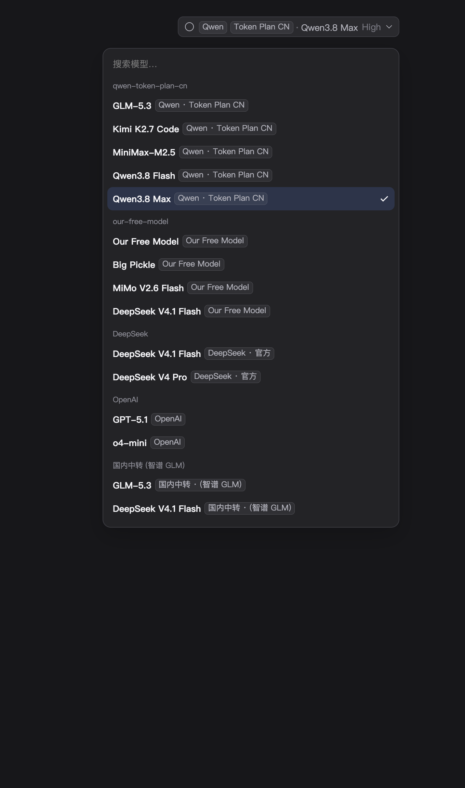
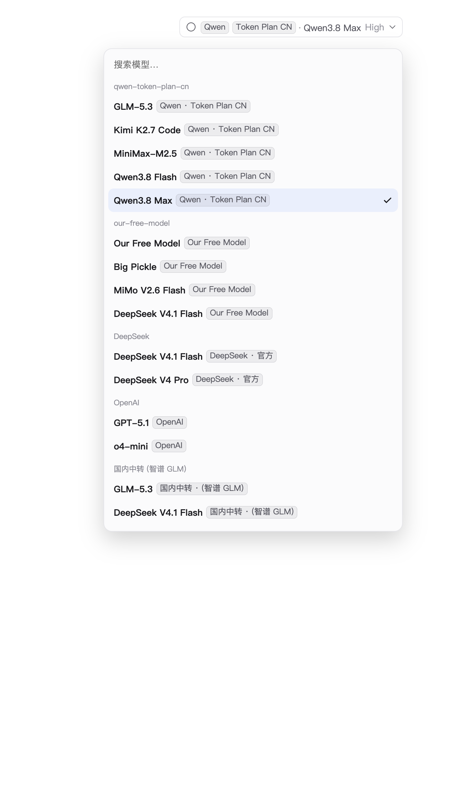

# 模型选择框供应商标签（dsh-model-picker-labels）

配置了多个模型供应商之后，DSH 的模型选择框只会显示模型名和你起的线路 ID，看不出某个模型到底走哪条线路。这个插件使用选择框自己的 `conversation.input.model.label` 标签位（DSH 公开的扩展点），做了三件事：

1. **输入框下方的模型按钮**：把当前线路直接写在模型名前面，例如 `Qwen Token Plan CN · Qwen3.8 Max  High`；ID 形态的线路（比如 `qwen-token-plan-cn`）会把 "Qwen" 和 "Token Plan CN" 分别做成小药丸，一眼就能看清当前模型来自哪条线路。
2. **模型列表**：每一行都是「模型名 + 淡色供应商标签」，比如 `GLM-5.3  [Qwen Token Plan CN]`、`DeepSeek V4.1 Flash  [Our Free Model]`，所以即使是同名模型（`DeepSeek V4.1 Flash` / `V4 Pro` 在两个供应商下都有），也能一眼分清它到底来自哪条线路。
3. **推理等级中文化**：供应商适配器公布的档位名原来是英文原样打印。中文页面下插件把目录里的档位名改成「中文(英文原词)」，按钮、根菜单的「推理等级」行和档位列表三处一起生效。两种写法都兼容：

   - 打印友好名：`Off` → `关闭(Off)`、`Low` → `低(Low)`、`High` → `高(High)`、`Max` → `最高(Max)`；
   - 直接打印枚举：`none` → `关闭(none)`、`minimal` → `轻度(minimal)`、`medium` → `中(medium)`、`xhigh` → `极高(xhigh)`、`max` → `最高(max)`。

   已经写成 `最大(Max)` 这种中英混写的会被规整为 `最高(Max)`，不会套娃。只改写显示用的 `name`，选中与持久化仍用档位 `id`；供应商只写中文的名字保持不动，切回英文页面会还原成英文原词。模型本身没有公布档位的（没有 Effort 行），插件不会凭空造出档位。

它不替换选择器本身，不改变点击、键盘操作、搜索和勾选逻辑。

> 早期的 v0.1 只把供应商标签插进原来的名字栏，如果哪个版本的模型选择框把这一格整格换成插槽，就会出现「只显示供应商、模型名消失」。v0.2 起插件先探测一次这一格的渲染方式：整格归插件时由插件自己写「模型名 + 供应商」，否则只补标签、原名字保留，两种情况都不会丢掉模型名。

## 效果

以下截图是给本插件的组件套上 DSH 模型选择器官方样式的静态效果（v0.2 的「每行模型名 + 供应商标签」；v0.3 起推理档位名显示为 `低(Low)` 这种中英对照）。

| 深色 | 浅色 |
| --- | --- |
|  |  |

## 名称怎么算

| 线路配置 | 按钮上显示 | 列表里的供应商药丸 |
| --- | --- | --- |
| `id: qwen-token-plan-cn`（没写 displayName） | `[Qwen] [Token Plan CN] · 模型名` | `Qwen Token Plan CN` |
| `id: our-free-model` | `[Our Free Model] · 模型名` | `Our Free Model` |
| `id: deepseek-official` | `DeepSeek 官方 · 模型名` | `DeepSeek 官方` |
| `id: xyz` + `displayName: 国内中转 (智谱 GLM)` | `国内中转 (智谱 GLM) · 模型名` | `国内中转 (智谱 GLM)` |
| `id: openai`（纯品牌） | 不动，沿用默认 | 不动，沿用默认 |

想让名字更好看，最省事的方法是给线路写 `displayName`：

```yaml
# <profile>/cordis.patch.yml（profile 层，覆盖在你自己的 bundle 之上）
- id: llm-pi-ai
  config:
    providers:
      qwen-token-plan-cn:
        displayName: 通义 · 编程套餐      # 插件会原样显示
        # ...
```

> 注意：`/model` 命令弹窗里的行由命令系统的 `label` 文本绘制，扩展点拿不到供应商数据，所以插件只覆盖了现在这个主模型按钮和它的列表。

## 安装

推荐用 DSH 自带的插件管理器装（会自动写 profile 的 `package.json` 与 `cordis.patch.yml`）：

- 插件管理器：`install_bundle`，target 填本目录的绝对路径
  `/Users/liuxiaowei/docker-server/wwwroot/dsh/dsh-model-selection-box`
- 或命令行：`dsh plugin --profile desktop add /Users/liuxiaowei/docker-server/wwwroot/dsh/dsh-model-selection-box`

装好后页面会通过 HMR 自动加载，无需重启。在 **设置 → 插件** 里能看到「模型选择框供应商标签」，可以用开关停用。

## 目录

| 文件 | 作用 |
| --- | --- |
| `index.js` | 宿主半身（空 `apply`，只为让包出现在插件列表里） |
| `client.js` | 浏览器半身：注册标签位、两个形态（按钮 / 列表药丸）、推理档位名中文化、样式 |
| `core.js` | 纯函数：线路名拆分、药丸文案、颜色/单字、档位名改写，`client.js` 里内嵌同一份 |
| `cordis.patch.yml` | bundle 挂载声明 |
| `locale/{zh,en}.json` | 插件列表里的标题和描述 |
| `icon.svg` | 插件图标 |
| `assets/` | 效果截图 |

## 开发

```bash
npm run check   # 语法、core 与 client 内嵌部分一致、manifest/导出、名字规则
npm run sync    # 改了 core.js 后，把它同步进 client.js
```

浏览器半身没有任何 Harness Client 包的依赖，只用 `react`（宿主提供）和 `--dsw-alias-*` 主题变量；唯一读写的宿主素材是标签位渲染出的 `<span data-provider-id data-model-id>` 包装。